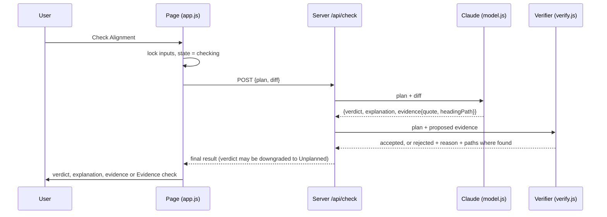

# SCOPELOCK — Technical Spec

## How This Works, In Plain Language
SCOPELOCK is a small Node app with three parts:

1. **The page** is plain HTML, CSS and JavaScript, served by the app. It holds the two editable panes (planning contract, proposed change), the Check Alignment button, and the result area. It tracks one thing: which state the result area is in (ready, checking, verdict, outdated, not checked, failed). It never sees the API key.
2. **The server** is a small Express app with one endpoint, `POST /api/check`. It receives the plan text and the diff, asks Claude for a verdict plus **one proposed piece of evidence** (a quote and the heading path it claims), then hands that proposal to the verifier.
3. **The verifier** is deterministic code with no AI in it. It splits the plan into headings and citable blocks. It accepts the evidence only if the proposed quote equals one **entire** block (after limited whitespace cleanup) **and** that block sits under the **exact** claimed heading path. If the check fails, the verdict becomes Unplanned, whatever Claude said.

The model interprets and the verifier decides what counts as evidence. That split is the product's kernel (`scope.md > The Unique Kernel`), so it is also the code's main boundary: the model module and the verifier module never import each other. A small orchestrator connects them.

Why this shape: it is one page, one model call and one deterministic check. A frontend framework, a database or separate frontend and backend projects would add surface area without strengthening the proof. Nothing is saved; reloading the page restores the sample.

## The Core Journey Through the System
PRD ref: `prd.md > The Core Journey`.



1. **Open the page.** Express serves `public/index.html`. `app.js` fills both panes from `public/sample.js` and sets the result state to **Ready to check**. No request is made.
2. **Press Check Alignment.** `app.js` checks that both panes are non-empty. It disables the panes, Load sample and the button, sets **Checking…**, takes a snapshot of both texts, and sends `POST /api/check` with that snapshot.
3. **Server.** `check.js` calls `model.js`, which asks Claude for a structured result. `check.js` passes the proposed evidence to `verify.js` and builds the final response. For the sample, Claude proposes `Conflict` with quote `Export results as CSV` and path `["Scope", "Later"]`. The verifier finds that exact block under that exact path, so the response is **CONFLICT · Stop** with verified evidence.
4. **Edit one decision.** The user moves `- Export results as CSV` under `## Now`. The pane's `input` event sees a completed verdict and switches the result to **Inputs changed — check again**. Nothing is sent.
5. **Check again.** Same flow. Claude now proposes `Aligned` with path `["Scope", "Now"]`, the verifier confirms it, and the page shows **ALIGNED · Proceed**.
6. **Load sample** at any time restores both panes from `sample.js` and resets to **Ready to check**.

## Stack
Chosen by the learner. The rationale is scope, not capability: one page, one model call and one deterministic verifier don't need a framework.

| Piece | Choice | Docs |
|---|---|---|
| Runtime | Node 22 (local: 22.18), ES modules (`"type": "module"`) | https://nodejs.org/docs/latest-v22.x/api/ |
| Server | Express 5 (static files + one JSON route) | https://expressjs.com/en/5x/api.html |
| UI | Plain HTML/CSS/JS, no build step, no framework | — |
| Model | Claude via `@anthropic-ai/sdk`, structured JSON output | https://docs.claude.com/en/api/messages · https://docs.claude.com/en/docs/build-with-claude/structured-outputs · https://github.com/anthropics/anthropic-sdk-typescript |
| Env loading | Node's built-in `--env-file-if-exists=.env` (no `dotenv` dependency) | https://nodejs.org/docs/latest-v22.x/api/cli.html#--env-file-if-existsconfig |
| Tests | Built-in `node:test` + `node:assert`; HTTP tests use built-in `fetch` against the app on an ephemeral port (no supertest) | https://nodejs.org/docs/latest-v22.x/api/test.html |

Runtime dependencies: `express`, `@anthropic-ai/sdk`. Nothing else.

**Verify early in the build:** that the installed SDK exports `jsonSchemaOutputFormat` from `@anthropic-ai/sdk/helpers/json-schema` and accepts the two-branch `anyOf` schema below. Structured outputs list `anyOf`, `enum` and `const` as supported; I couldn't confirm the helper's exact import path locally. Also confirm that `--env-file-if-exists` works on this Node version.

## Where It Runs and How Someone Tries It
- **Local only.** No deployment for the POC.
- Requirements: Node 22.9 or later, plus an Anthropic API key.
- Setup:
  ```bash
  npm install
  cp .env.example .env   # then fill in ANTHROPIC_API_KEY
  npm start              # node --env-file-if-exists=.env server.js
  ```
- Open `http://localhost:3000` (`PORT` overrides 3000).
- `npm test` runs all automated tests. They **never** call the Anthropic API: the model is always injected as a mock, and a test run fails rather than reaching the network.
- `npm run smoke` runs the live model smoke checks (see `Live Model Smoke Checks`). It costs a small number of API calls and is never part of `npm test`.
- **Demo recording:** start the app, show the preloaded sample, run the flip test (Conflict → move one line → outdated state → Aligned), then optionally paste an unrelated diff to show Unplanned.
- **Submission:** demo video + public GitHub repo. The README carries the setup steps above. `.env` stays ignored and `.env.example` is committed.

## Look and Feel
Carried from `prd.md > Look and Feel`. No new design decisions.
- Implemented as CSS custom properties in `public/styles.css`, using the token set already used in `prd.html`:
  - neutrals: `--bg #f7f7f5`, `--surface #fff`, `--ink #1b1d1f`, `--muted #5f656b`, `--line #dcdcd7`
  - verdicts: green `#2f7a4f`, amber `#9a6a12`, red `#b0392f`, plus faint tinted backgrounds for the action chip only
- Typography: `system-ui` stack for the interface, and `ui-monospace, SFMono-Regular, Menlo, Consolas, monospace` for both panes, quotes and locations.
- Verdict styling: a 3px left border on the result card plus a colored verdict word and action chip. No full-card fills, gradients, glows, chat bubbles or illustrations.
- Load sample is a small ghost button in the header. Check Alignment is the only solid button.
- Panes sit side by side, stacking below about 760px. The page has a light theme only; a dark theme isn't needed for the POC.
- Interface copy is short and declarative. The result is always titled **Product alignment**.

## Components

### Page shell — `public/index.html`, `public/styles.css`
Static markup: header (name + Load sample), two labeled `<textarea>` panes (the diff pane has the technical-quality label above it), the Check Alignment button, the result region (`aria-live="polite"`), and inline per-pane "required" messages.
PRD ref: `prd.md > Screens and Layout`, `prd.md > Look and Feel`.

### Sample — `public/sample.js`
Exports `SAMPLE_PLAN` and `SAMPLE_DIFF` as an ES module. The page and the tests both import it.
- `SAMPLE_PLAN` is a short Markdown plan whose top heading is `# Scope`. It has `## Now` (a few items for the flip-test app) and `## Later` (including `- Export results as CSV`).
- `SAMPLE_DIFF` is a coherent unified diff that adds a CSV export button and handler.
PRD ref: `prd.md > Sample Preload and Load Sample`.

### UI controller — `public/app.js`
Owns the result state machine and renders it. It never interprets plan text.

| State | Entered when | Result area shows |
|---|---|---|
| `ready` | first load, Load sample | **Ready to check** |
| `notChecked` | Check pressed with an empty pane, **or** a pane emptied after a verdict | **Not checked** + inline "Planning contract required" / "Proposed change required" |
| `checking` | request in flight; panes, Load sample and button disabled | **Checking…** |
| `verdict` | 200 response | verdict word · action, explanation, Evidence or Evidence check |
| `outdated` | any `input` edit while in `verdict` and both panes are non-empty | *Inputs changed — check again. The previous result no longer applies to the current inputs.* |
| `failed` | non-200, network error, or malformed response | *Check failed. SCOPELOCK couldn't complete the analysis. Your inputs are unchanged.* + **Try again** (reruns the check) |

Rules:
- Emptying a pane takes precedence over `outdated`.
- Edits while in `ready`, `outdated` or `failed` don't change the state. Edits in `notChecked` clear that pane's required message once it is non-empty.
- **Technical-quality label:** on every diff `input`, compare `diffPane.value === SAMPLE_DIFF`. If they match, show *Sample scenario · known-working change* plus the assumption note. Otherwise show *Technical quality: not evaluated*.
- Heading paths render as `path.join(" > ")`, display only.

PRD ref: `prd.md > Alignment Check`, `prd.md > States and Boundaries`, `prd.md > Technical Quality Labeling`.

### Server — `server.js`
Creates the Express app through `createApp({ model })`, so tests can inject a mock model. It serves `public/` statically, applies `express.json({ limit: "1mb" })`, and mounts `POST /api/check`. It only listens when run directly, using `PORT || 3000`. At startup it logs a warning if `ANTHROPIC_API_KEY` is missing; it doesn't crash, and checks then return `check_failed`.

#### `POST /api/check` contract
Request: `{ "plan": string, "diff": string }`

Responses:
- **400** `{ "status": "invalid_input", "missing": ["plan" | "diff", …] }` if either value is missing or whitespace-only. The model isn't called. (The page checks for empty panes first, so this is defense in depth.)
- **200** `{ "status": "verdict", "verdict": "aligned" | "conflict" | "unplanned", "explanation": string, "evidence": Evidence | null, "evidenceCheck": EvidenceCheck | null }`
  - `Evidence = { "quote": string, "path": string[] }`, present only for verified aligned/conflict results
  - `EvidenceCheck = { "proposedQuote": string, "claimedPath": string[], "reason": "quote_not_found" | "wrong_path", "foundPaths": string[][] }`, present only when proposed evidence was rejected
  - `unplanned` with both fields null means "No relevant planning decision was found for this change."
- **502** `{ "status": "check_failed" }` for any model or API failure, refusal, truncation, or malformed structured output.

PRD ref: `prd.md > Alignment Check`, `prd.md > Evidence Verification`, `prd.md > States and Boundaries`.

### Orchestrator — `src/check.js`
`runCheck({ plan, diff }, model)` turns the model's proposal into the final response. Decision table:

| Model says | Evidence | Final result |
|---|---|---|
| aligned / conflict | proposed, verifies | same verdict + `evidence` |
| aligned / conflict | proposed, fails verification | `unplanned` + `evidenceCheck`; the explanation is replaced with a fixed sentence saying the proposed evidence couldn't be verified |
| unplanned | `null` | `unplanned`, `evidence: null`, `evidenceCheck: null` |
| aligned / conflict | `null` | **check_failed**: structurally invalid |
| unplanned | non-null | **check_failed**: structurally invalid |

The schema already rules out the last two rows. If one reaches the application anyway, the orchestrator rejects it as `check_failed` instead of repairing it (`prd.md > States and Boundaries`). The orchestrator never re-interprets the verdict. It only downgrades a valid proposal whose evidence fails verification.

### Model adapter — `src/model.js`
`createModel({ apiKey, modelName })` returns `{ propose(plan, diff) }`. This is the only file that imports `@anthropic-ai/sdk`.
- Model: `process.env.ANTHROPIC_MODEL`, default `claude-opus-5-5`. The model name appears nowhere else in the code.
- Call: `client.messages.parse()` with `max_tokens: 16000`, `output_config: { effort: "medium", format: jsonSchemaOutputFormat(PROPOSAL_SCHEMA) }` (helper from `@anthropic-ai/sdk/helpers/json-schema`), a fixed system prompt, and one user message that wraps the inputs in `<planning_contract>` and `<proposed_change>` tags. Thinking is left at the model default; Opus 5.5 always uses adaptive thinking.
- Client options: `timeout: 60_000`, `maxRetries: 1`.
- **Output schema: a top-level object wrapping two branches.** `jsonSchemaOutputFormat` (SDK 0.133.0) only accepts a top-level `type: "object"`, so the schema is `{ type: "object", required: ["proposal"], additionalProperties: false, properties: { proposal: { anyOf: [...] } } }`. The name `proposal` matches the architecture: Claude produces a proposal; `check.js` produces the final result. Each `anyOf` branch has all fields required and `additionalProperties: false`:
  - `{ verdict: enum["aligned","conflict"], explanation: string, evidence: { quote: string, headingPath: string[] } }`, where evidence is **required** (non-null)
  - `{ verdict: const "unplanned", explanation: string, evidence: null }`, where evidence **must be null**
- **Reading the result:** check `stop_reason` first. Anything other than `end_turn` (for example `refusal` or `max_tokens`) throws. Then read `message.parsed_output.proposal`; if `parsed_output` or `proposal` is null or missing, throw. Finally run a small defensive branch check: verdict and evidence must match one of the two branches, and `headingPath` must be a string array. Any violation throws, and every throw becomes `check_failed`. There's no hand-written `JSON.parse`.
- **Prompt rules** (the reliability levers): explain the three verdicts in the PRD's terms. Say the quote must be the **complete** text of exactly one planning line or paragraph, copied character for character, with the leading list marker/checkbox/`>` removed and inline Markdown kept. Say `headingPath` is the list of enclosing heading texts from outermost to innermost, without `#`, exactly as written. Say it must cite nothing when no decision governs the change. Include one short worked example.

PRD ref: `prd.md > Alignment Check`, `prd.md > Evidence Verification`.

### Plan parser — `src/markdown-blocks.js`
`parsePlan(text) → Array<{ text: string, path: string[] }>`: the citable blocks, each with its governing heading path. It is pure and has no dependencies.

Rules (agreed with the learner, plus the derived details marked *derived*):
1. Normalize `\r\n` and `\r` to `\n`.
2. **Headings:** only ATX `#`–`######` (up to 3 leading spaces, then 1–6 `#`, then a space or end of line). The label is trimmed, with any trailing closing `#` run removed and internal whitespace collapsed. A level-N heading replaces the stack entry at level N and drops deeper levels. Heading text isn't citable. If levels are skipped (`#` then `###`), the path is simply `["A", "C"]` (*derived*).
3. **List item:** a line matching `^\s*([-*+]|\d+[.)])\s+`, plus following lines that are **indented** (≥ 2 spaces or a tab), non-blank, and not themselves list markers. An indented marker line starts a new (nested) item block.
4. **Paragraph:** consecutive non-blank lines that aren't headings or list markers. A blank line, heading or list marker ends it. An unindented line after a list item starts a paragraph; there is no lazy continuation (*derived*).
5. **Block syntax stripped:** the leading list marker, then a task checkbox `[ ]`/`[x]`/`[X]`, and a leading `>` (with one optional space) on each line. Nothing else is stripped.
6. **Fenced code** (```` ``` ```` or `~~~`): lines inside a fence are neither headings nor citable (*derived*; this stops a `#` in a code sample from changing the path).
7. Setext headings (`===`/`---` underlines) aren't headings; their lines are paragraph text (*derived*, consistent with "ATX only").
8. Blocks before any heading have path `[]`.

`normalize(s)`: replace runs of ASCII whitespace (space, tab, `\n`) with one space, then trim. Case, punctuation, inline Markdown and non-ASCII characters are preserved. No fuzzy matching, lowercasing, stemming or similarity.

PRD ref: `prd.md > Evidence Verification`, `prd.md > Product Decisions` (full heading path).

### Verifier — `src/verify.js`
`verifyEvidence(plan, { quote, headingPath }) → { ok: true } | { ok: false, reason, foundPaths }`:
- `q = normalize(quote)` and `claimed = headingPath.map(normalize)`.
- `matches` = blocks where `normalize(block.text) === q` (**whole-block equality**, not substring).
- If `matches` is empty, the result is `{ ok: false, reason: "quote_not_found", foundPaths: [] }`.
- If any match's path equals `claimed` element by element (same length), the result is `{ ok: true }`. Duplicates are fine as long as one occurrence is under the claimed path.
- Otherwise the result is `{ ok: false, reason: "wrong_path", foundPaths: <distinct paths of matches> }`.

The page renders the rejection as the secondary **Evidence check** note. `quote_not_found` reads "Rejected: quote not found verbatim as a complete planning line." `wrong_path` reads "Rejected: quote found under {foundPaths joined}, not under the claimed location." Exact copy can be set during the build (`prd.md > Build-Time Copy Details`).
PRD ref: `prd.md > Evidence Verification`.

### Live Model Smoke Checks — `scripts/smoke-live.js`
`npm run smoke` runs only on manual request. It needs `ANTHROPIC_API_KEY` and goes through the real `model.js` + `check.js`. It runs the live-meaningful validation cases (1, 2, 3 and 6 below) 3 times each and prints, per run: model verdict, proposed quote/path, verification result, and final verdict. At the end it prints a pass rate. **Bar:** the canonical flip test (cases 1 and 2) passes in every run. That's about 12 calls.
If the model misses, the agreed first response is to **improve the prompt and output instructions, never to loosen the verifier**. The next lever after that is listed under `Decisions and Open Issues`.

## Validation Set
`test/fixtures/validation-cases.js` holds shared plan/diff fixtures and mocked model responses. The unit tests use them with mocks, and the smoke script uses them live.

| # | Case | Mocked model proposal | Expected final |
|---|---|---|---|
| 1 | Canonical sample, CSV under `Later` | conflict, `Export results as CSV`, `["Scope","Later"]` | **conflict**, evidence verified |
| 2 | Same line moved to `Now`, same diff | aligned, same quote, `["Scope","Now"]` | **aligned**, evidence verified |
| 3 | Unrelated diff (e.g. a README typo fix) | unplanned, `null` | **unplanned**, no evidence |
| 4 | Canonical sample, wrong path | conflict, `Export results as CSV`, `["Scope","Now"]` | **unplanned**, `wrong_path`, foundPaths `[["Scope","Later"]]` |
| 5a | Partial quote | conflict, `Export results`, `["Scope","Later"]` | **unplanned**, `quote_not_found` |
| 5b | Paraphrase | conflict, `CSV export of results`, `["Scope","Later"]` | **unplanned**, `quote_not_found` |
| 6 | Same block text under `Scope > Later` and `Roadmap > Later` | conflict, quote, `["Roadmap","Later"]` | **conflict**; claiming `["Later"]` alone → `wrong_path` |

Extra parser-level unit tests: CRLF input, wrapped list items, a task checkbox, a blockquote, a `#` inside fenced code, skipped heading levels, a whole-block match with inline `**bold**` preserved, plus orchestrator tests showing that structurally invalid proposals (Aligned/Conflict with `null` evidence, Unplanned with non-null evidence, missing `parsed_output`, `stop_reason` `refusal`/`max_tokens`) → check_failed.

## Data Model
There's no persistence. Every piece of data:

| Data | Lives in | Updated by | After reload |
|---|---|---|---|
| Plan text, diff text | the two `<textarea>`s | user edits, Load sample | sample restored |
| Result state + last response | variables in `app.js` | the state machine above | `ready` |
| Request snapshot | `fetch` body only | Check Alignment | gone |
| Parsed blocks | in memory per request in `verify.js` | rebuilt for each check | — |
| API key, model name | `.env` → `process.env` (server only) | the developer | unchanged |

## File Structure
```
scopelock/
├── server.js                  # createApp({model}); static + POST /api/check; listens on PORT||3000
├── src/
│   ├── check.js               # orchestrator: model proposal → verifier → final response (decision table)
│   ├── model.js               # ONLY file using @anthropic-ai/sdk: prompt, JSON schema, shape validation
│   ├── markdown-blocks.js     # parsePlan + normalize: headings → paths, citable blocks
│   └── verify.js              # verifyEvidence: whole-block equality under exact path
├── public/
│   ├── index.html             # single page: header, two panes, button, result area
│   ├── styles.css             # tokens + layout from Look and Feel
│   ├── app.js                 # UI state machine, rendering, fetch
│   └── sample.js              # SAMPLE_PLAN, SAMPLE_DIFF (shared with tests)
├── test/
│   ├── fixtures/
│   │   └── validation-cases.js  # cases 1–6: plans, diffs, mocked proposals, expectations
│   ├── markdown-blocks.test.js  # parser rules
│   ├── verify.test.js           # verifier outcomes
│   ├── check.test.js            # orchestrator decision table with mocked model
│   └── api.test.js              # HTTP: 200/400/502 shapes via createApp + mock model + fetch
├── scripts/
│   └── smoke-live.js          # npm run smoke — live API, never in npm test
├── .env.example               # ANTHROPIC_API_KEY=, ANTHROPIC_MODEL=claude-opus-5-5, PORT=3000
├── .gitignore                 # existing: .env*, learner profile; add node_modules/
├── package.json               # "type":"module"; scripts: start, test (node --test), smoke
├── README.md                  # what it is, setup, run, test, smoke, limitations
└── devpost/                   # planning docs (not part of the app)
```

## External Services and Dependencies
**Anthropic Messages API** (the only external service)
- Endpoint: `POST https://api.anthropic.com/v1/messages`, via `@anthropic-ai/sdk` `messages.parse` + `jsonSchemaOutputFormat`
- Auth: `ANTHROPIC_API_KEY` (server-side only, header set by the SDK)
- Payload: `model` (env), `max_tokens: 16000`, `system`, one `user` message, `output_config: { effort: "medium", format: jsonSchemaOutputFormat(PROPOSAL_SCHEMA) }`
- Response: `message.parsed_output.proposal` (the object matching one schema branch). Check `stop_reason` before reading it.
- Cost: Opus 5.5 is $4 / $20 per million input/output tokens. One check is a few thousand tokens, so a smoke run of about 12 calls costs well under $1. Rate limits depend on the account tier; irrelevant at this volume.
- Docs: https://docs.claude.com/en/api/messages · https://docs.claude.com/en/docs/build-with-claude/structured-outputs · https://docs.claude.com/en/docs/about-claude/models/overview

## Important Failure Modes
- **Model proposes evidence that doesn't verify** (paraphrase, missing inline Markdown, wrong path) → **Unplanned · Review plan** with the Evidence check note. This is correct behavior; how often it happens is measured by the smoke checks.
- **API failure, timeout (60s), refusal, `max_tokens` truncation, or malformed JSON** → 502 → **Check failed** + Try again, inputs untouched. Never shown as Unplanned.
- **Missing API key** → server starts with a warning; each check → **Check failed**. The README says to set `.env`.
- **Slow response** → the **Checking…** state with locked inputs covers it; there's no streaming.

## What Was Simplified and Why
- **Whole-block quote equality** instead of clause-level citation. It is a stronger trust property, and planning decisions are usually short list items. Clause-level citation would need substring rules plus anti-trivial-quote safeguards.
- **A small hand-written Markdown block parser** instead of a full CommonMark library. The rules are few, deterministic and tested exhaustively. A library would bring its own interpretation of edge cases (lazy continuation, setext) that we would then have to reason about.
- **Express serving static files** instead of a frontend framework or a separate client. It's one page.
- **No streaming, no persistence, no history.** A single-shot check doesn't need any of them (`prd.md > Deferred From the POC`).
- **No server-side refusal fallback** (`fallbacks` parameter). Any refusal becomes Check failed, which the PRD already defines, and the request stays portable across `ANTHROPIC_MODEL` values.

## Decisions and Open Issues

### Learner decisions
- **Stack:** Node 22 + Express + plain HTML/CSS/JS, one `/api/check` endpoint. No DB, auth, persistence, queue, or split projects. Tradeoff accepted: no component framework, which is fine for one page.
- **Model:** Claude via the Anthropic API, server-side key, model name from `ANTHROPIC_MODEL`. The model proposes and never verifies.
- **Heading paths:** ATX only, normal heading stack, **exact full-path match**, paths carried as arrays (`["Scope","Later"]`) and rendered with ` > ` for display only.
- **Normalization:** CRLF/LF, trimming, and collapsing ordinary whitespace only. Words, case, punctuation and inline Markdown are preserved. Nothing fuzzy.
- **Quote matching:** the normalized quote must equal a **complete** normalized block. Leading list/checkbox/blockquote syntax is stripped, quotes can't span blocks, headings aren't citable, and duplicates are accepted if one occurrence is under the claimed path.
- **Running:** local only, `npm start`, `PORT` override, `node:test`, model mocked in all automated tests, no deployment.

### Derived implementation details (agent-proposed, following from the above)
Fenced code is excluded from parsing, setext headings are treated as text, there's no lazy list continuation, and pre-heading blocks have path `[]`. The explanation is replaced when evidence is rejected. Effort is `medium`; timeout is 60s with 1 retry. The learner accepted all of these at review.

### Changes from review (learner)
- Use `messages.parse()` + `jsonSchemaOutputFormat` and read `parsed_output`, instead of `create` + `JSON.parse`.
- The schema enforces two branches tied to the verdict (aligned/conflict → evidence required; unplanned → evidence null). Impossible combinations are never silently repaired; they become `check_failed`.

### The learner's main uncertainty, and how the build checks it
**Question:** Will the model reliably reproduce the *complete* block exactly and pick the *correct full heading path*, given the deliberately strict contract? If it doesn't, the verifier will correctly reject the evidence, and the result will be a false Unplanned.
**How it's checked:** the verifier's behavior is pinned by mocked unit tests (validation cases 1–6). The model's reliability is measured separately with `npm run smoke` against the real API: canonical flip test × 3 runs must be 3/3, and cases 3 and 6 are reported too.
**If it's unreliable:** improve the prompt and output instructions first; the verifier never gets looser. Prompt levers, in order: (1) sharper rules plus a worked example; (2) the server annotates the plan sent to the model with each block's computed heading path, so the model copies rather than infers. Verification still runs against the user's original text, so the trust boundary is unchanged.

### Known boundary (noted, not blocking)
The verifier checks *where* the quote is, not whether that location fits the verdict. For example, it doesn't stop the model from saying Aligned while citing a `Later` line. That interpretation is the model's job by design (`scope.md > The Unique Kernel`). The smoke checks watch for it on the canonical cases.

### Open
None blocking. Carried from `prd.md > Open Questions`: none.
